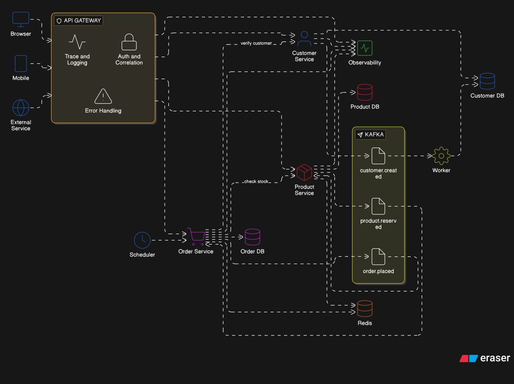

# Architecture Diagram

> Render this file in any Markdown viewer that supports Mermaid (GitHub, GitLab, VS Code with the Mermaid extension, Obsidian, etc.).



---

## Flow reference

### Read request — `GET /api/v1/products/:id`

```
Client → Middleware stack → Handler (span: product.handler.GetByID)
  → GetProductUseCase (span: product.usecase.GetProduct)
      → Cache.Get (Redis)  ──hit──→ return response
      → [miss] Repository.FindByID (span: product.repository.FindByID)
                  → DBResolver → Replica 1 or 2  (SELECT, random policy)
                  → otelgorm auto-span for the SQL query
      → Cache.Set (Redis, TTL 5 min)
  → APIResponse[ProductResponse]
```

### Write request — `POST /api/v1/products`

```
Client → Middleware stack → Handler (span: product.handler.Create)
  → CreateProductUseCase (span: product.usecase.CreateProduct)
      → Repository.Create (span: product.repository.Create)
            → DBResolver → Primary  (INSERT)
            → otelgorm auto-span for the SQL query
      → Publisher.Publish (span: kafka.publish.product.created)
            → Kafka broker  (message + W3C traceparent header)
  → 201 APIResponse[ProductResponse]
```

### Update / Delete — cache invalidation

```
UpdateProductUseCase:
  1. Repository.FindByID  → Replica  (read)
  2. Repository.Update    → Primary  (write)
  3. Cache.Delete         → Redis    (immediate invalidation)
  4. Publisher.Publish    → Kafka    (product.updated)
```

### Event consumption — Worker service

```
Kafka topic: product.created / product.updated
  → Consumer extracts W3C traceparent header
  → Continues the distributed trace from the originating request
  → Idempotent handler (search index sync, email, audit log, …)
  → Writes back to Primary if needed
```

### Trace propagation across services

```
Upstream service
  │  HTTP request + traceparent header
  ▼
otelgin middleware
  → extract existing trace context  (joins upstream trace)
  → OR create new root span         (this is the trace origin)
TraceContext middleware
  → stores trace_id + span_id in Gin context
  → Logger reads them → every log line is traceable
Handler / UseCase / Repository / Cache
  → each creates a child span       (full waterfall in Jaeger / Tempo)
Publisher
  → injects traceparent into Kafka message headers
  → Worker extracts it → trace continues across the message bus
```

### Dependency rule (Clean Architecture)

```
domain          ← no internal imports
usecase         ← domain (interfaces only)
repository      ← domain (interfaces only)
cache           ← domain (interfaces only)
gateway         ← domain (interfaces only)
delivery/http   ← usecase + domain + api/http/v1/response
api/http/v1     ← delivery (handlers) + domain (error mapper)
cmd/*           ← all layers (wiring only)
pkg/*           ← no internal imports
```
