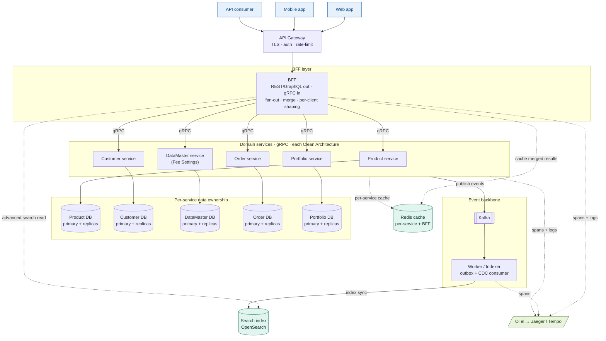
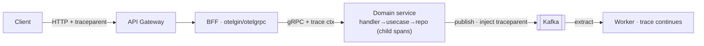

## Overview

The target architecture is a set of domain-oriented services behind a
Backend-for-Frontend (BFF). Clients talk only to the BFF over REST/GraphQL; the
BFF fans out to the domain services over gRPC, merges the results into
screen-shaped payloads, and shapes them per client. Each domain service follows
Clean Architecture internally (handlers → usecase → repository/cache/gateway) and
**owns its own data** (Postgres primary + read replicas). Writes emit domain
events to Kafka; a worker consumes them to keep a shared search index in sync and
run other side effects. OpenTelemetry spans and trace-correlated logs flow through
the gateway, the BFF, every gRPC hop, and across Kafka.

## System diagram



## Design principles

- **BFF is opinionated, not generic.** It exposes endpoints shaped to specific
  screens and is owned by the frontend team. It is not a general-purpose API; if
  it drifts toward "handle anything," that's a smell to split it.
- **REST/GraphQL out, gRPC in.** Browser-friendly, debuggable transport on the
  outer edge; binary, strongly-typed, HTTP/2 contracts on the hot internal paths.
- **Each service owns its data.** No service reaches into another's tables; data
  is shared only via gRPC calls or events.
- **Fan out in parallel, degrade gracefully.** The BFF calls services
  concurrently under a shared deadline and decides per source whether a failure
  fails the whole response or returns partial data.
- **Async where the caller need not wait.** State changes commit synchronously and
  publish events; downstream effects (search index sync, notifications) run in the
  worker.
- **Traceable by default.** A trace context flows through gateway → BFF → every
  gRPC hop → Kafka → worker, so one `trace_id` reconstructs the full path.
- **Clean Architecture inside each service.** Dependencies point inward toward
  `domain`; inner layers define interfaces, outer layers implement them.

## Components

| Component         | Responsibility                                                              |
|-------------------|-----------------------------------------------------------------------------|
| API Gateway       | TLS termination, authentication, global rate limiting, routing              |
| BFF               | Per-client REST/GraphQL endpoints; parallel gRPC fan-out; merge/reshape; aggregated-result cache |
| Domain services   | One bounded context each (Product, Customer, DataMaster/Fee Settings, Order, Portfolio); gRPC server; own DB |
| Worker / Indexer  | Consumes Kafka events (outbox/CDC); keeps the search index in sync; other side effects |
| Search index      | Read model for advanced filter / full-text / faceted queries                |
| Redis             | Hot-path cache (per-service namespaces; BFF caches merged payloads)         |
| Kafka             | Event backbone between services and the worker                              |

### Clean Architecture layers (within each domain service)

| Layer            | Responsibility                                                        | May import           |
|------------------|-----------------------------------------------------------------------|----------------------|
| `domain`         | Entities, value objects, repository/cache/gateway **interfaces**      | nothing internal     |
| `usecase`        | Business orchestration; depends only on domain interfaces             | `domain`             |
| `repository`     | GORM persistence over DBResolver (primary/replica)                    | `domain`             |
| `cache`          | Redis read-through / write-invalidate                                 | `domain`             |
| `gateway`        | Kafka publisher; trace-context injection into message headers         | `domain`             |
| `delivery/grpc`  | gRPC handlers, request binding, response shaping                      | `usecase`, `domain`  |
| `cmd/*`          | Composition root (wiring only)                                        | all layers           |
| `pkg/*`          | Shared utilities                                                      | nothing internal     |

## Request flows

### Aggregated read — BFF fan-out (e.g. `GET /api/v1/order-form-data`)

A screen that needs data from several services makes **one** call; the BFF fans
out concurrently and returns exactly the shape the UI renders.

```
Client → API Gateway → BFF (span: bff.handler.OrderFormData)
  → errgroup fan-out under a shared context deadline:
        ├─ gRPC Product service    → ProductDB    (read replica)
        ├─ gRPC Customer service   → CustomerDB   (read replica)
        ├─ gRPC DataMaster service → DataMasterDB (read replica)   // fee settings
        └─ gRPC Portfolio service  → PortfolioDB  (read replica)
  → merge into { products[], customer, feeSettings, eligibility } + cache (Redis, short TTL)
  → APIResponse[OrderFormResponse]
```

Degradation policy is per source: e.g. if the DataMaster service is down, return
products with `feeSettings: null` rather than failing the whole screen.

### Advanced search — `GET /api/v1/products` (filter / full-text)

Complex multi-field, full-text, or faceted queries are served by the search
index, **not** by Postgres.

```
Client → API Gateway → BFF (span: bff.handler.SearchProducts)
  → SearchGateway.Query (search index)
        → keyset / search_after pagination (never deep from/offset)
        → optional short-TTL cache keyed by normalized filter set
  → APIResponse[[]ProductResponse] + page cursor
```

Guardrails at the BFF: allow-listed sort fields (never raw client column names),
a cap on filter fields, and a hard result cap.

### Write — `POST /api/v1/orders`

```
Client → API Gateway → BFF (span: bff.handler.CreateOrder)
  → gRPC Order service (span: order.usecase.CreateOrder)
        → Repository.Create → DBResolver → Primary  (INSERT + outbox row, 1 txn)
        → otelgorm auto-span for the SQL query
  → outbox/CDC → Publisher.Publish → Kafka (order.created + W3C traceparent)
  → 201 APIResponse[OrderResponse]
```

### Update / Delete — cache invalidation

```
Order service UpdateOrder:
  1. Repository.FindByID  → Replica  (read)
  2. Repository.Update    → Primary  (write + outbox, 1 txn)
  3. Cache.Delete         → Redis    (immediate invalidation)
  → CDC → Kafka (order.updated)
The BFF also evicts any aggregated cache entries that contained this order.
```

### Event consumption — Worker / Indexer

```
Kafka topic: order.created / product.updated / feesettings.updated / customer.updated / …
  → Consumer extracts W3C traceparent header (continues the originating trace)
  → Idempotent handler (search index upsert, notifications, audit log, …)
  → Writes back to a service's Primary only via that service's API, never directly
```

## Trace propagation across services



- `otelgin`/`otelgrpc` extract an upstream `traceparent` (joining the trace) or
  start a new root span. Each layer opens a child span → full waterfall in
  Jaeger/Tempo.
- The publisher injects `traceparent` into Kafka headers; the worker extracts it
  so the trace continues across the bus.
- A TraceContext middleware stores `trace_id` + `span_id` in context; the logger
  reads them, so every log line is correlatable to a span.

## Data strategy

- **Each service owns its store.** Writes to that service's primary, reads to its
  replicas, hot reads to its Redis namespace.
- **BFF cache:** merged/aggregated payloads are cached keyed by the normalized
  request (plus tenant, e.g. `cimb`); invalidated when a contributing service
  emits a relevant event.
- **Cache invalidation:** delete-on-write for entities; the BFF evicts aggregated
  entries on related events.
- **Search index:** a shared read model maintained asynchronously by the worker
  from the outbox/CDC stream. Eventually consistent (typically sub-second), so
  read-your-writes cases read the owning service directly, not the index.

## Consistency & failure handling

- **Deadlines.** A `context.Context` deadline set at the BFF propagates through
  every gRPC and DB call so a slow downstream can't exhaust connection pools.
- **Connection pools.** Safe defaults with saturation monitoring; replica pools
  configured consistently with the primary in each service.
- **Partial failure.** The BFF decides per source whether to fail or degrade;
  circuit breakers fail fast on a struggling downstream.
- **Outbox + CDC.** Avoids dual-write inconsistency — the business row and the
  event row commit in the same transaction; CDC streams committed changes.
- **Idempotent consumers.** The worker handles redeliveries idempotently
  (search upsert by id, deduped side effects).

## Scaling notes

- Gateway, BFF, and each domain service are stateless → independent horizontal
  scale behind HPAs on RPS/CPU.
- Separate BFFs per client type (web vs mobile) when payload needs diverge enough
  to justify it.
- Use **batch gRPC endpoints** (`GetByIDs([]id)`) rather than per-id loops to
  avoid network-level N+1 in the fan-out.

## Dependency rule (within each domain service)

```
domain          ← no internal imports
usecase         ← domain (interfaces only)
repository      ← domain (interfaces only)
cache           ← domain (interfaces only)
gateway         ← domain (interfaces only)
delivery/grpc   ← usecase + domain
cmd/*           ← all layers (wiring only)
pkg/*           ← no internal imports
```
